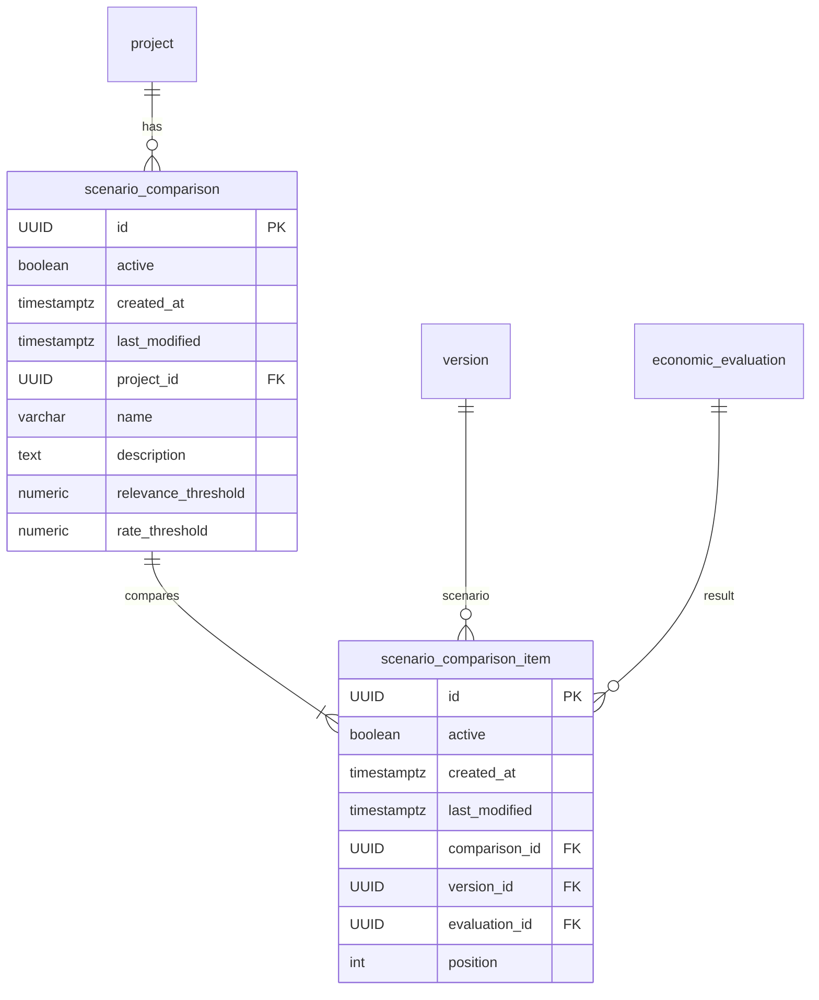

# Scenario comparison

The comparison puts the **results of two to eight scenarios side by side** — from
one project or from several — **compared with each other: no scenario is a
reference**. For every indicator it says who leads, who comes last and how far each
one is from the best, and it points out the differences that matter, in a
form a non-technical reader (a director) can take in at a glance. A scenario's
"result" is its **latest simulation** (a saved, immutable `EconomicEvaluation`),
and only while it is **up to date**: if the scenario changed since, it has to be
simulated again, which the screen lets you do in place.

Package: `org.enerscope.comparison` (`controller`, `service`, `repository`,
`model`, `model/enums`, `dto`). Frontend: `pages/ComparisonsPage.tsx` (step 1),
`pages/ComparisonResultPage.tsx` (step 2), `components/comparison/*`.

## Rules

- **Scenarios from any project.** Each version is resolved to its own project
  (`ProjectRepository.findIdByVersionId`) and the caller needs `VIEW_PROJECT` on
  every one of them (otherwise `403`; an unknown or deleted version is `404`). The
  comparison itself is saved in, and listed under, the project of the URL; saving
  and deleting need `EDIT_PROJECT` there.
- **Always the latest simulation.** A request names scenarios only
  (`{ "items": [{ "versionId": … }] }`); each one uses its newest evaluation.
- **Only if it is up to date.** `ScenarioStatusService.isUpToDate` compares what the
  simulation froze — economic configuration, physical nodes and connections —
  with the scenario as it is now (JSON round trip, entities sorted by id; audit
  timestamps and diagram positions ignored, since they never reach the simulator;
  unpublished drafts do not count). A changed scenario is refused with
  `Scenario changed since its last simulation: <name>`; one never simulated with
  `Scenario has never been simulated: <name>`.
- **Statuses** (`GET /scenarios`): `UP_TO_DATE`, `OUTDATED`, `NEVER_SIMULATED`,
  `SIMULATING` (a job queued or running, with its progress), plus whether the
  scenario can be simulated now (`ready` + `readinessErrors`, from the scenario
  configuration's readiness check) and whether the caller may (`canSimulate`,
  the per-version rule that authorizes submitting a simulation, from `VersionAccessService`). A job that failed after the latest result is
  reported too.
- 2–8 scenarios, the same one only once. Eight is the size of the validated
  categorical palette that identifies scenarios on screen.
- A saved comparison keeps the simulations it was made with: reopening it shows
  them even if the scenarios changed later (it is a record of that run). If one
  of its versions is later deleted it can no longer be read.

## What is compared

Every scenario is measured against the others. The order they were picked in only
decides their colour on screen.

| Category | Indicator | Definition | Better |
| --- | --- | --- | --- |
| Financial | `NPV` | Saved net present value | higher |
| Financial | `IRR` | Saved IRR, only when `CALCULATED` | higher |
| Financial | `ROI` | Net cash flow over the horizon / CAPEX | higher |
| Financial | `ROE` | Average annual result after tax / CAPEX | higher |
| Financial | `SIMPLE_PAYBACK`, `DISCOUNTED_PAYBACK` | Saved recovery period, only when `RECOVERED` | lower |
| Cost | `CAPEX` | Capitalizable expense entries (asset purchases) | lower |
| Cost | `OPEX` | Other cash expense entries (excludes depreciation and income tax) | lower |
| Cash flow | `REVENUE` | Cash income entries | higher |
| Cash flow | `TAXES` | Sum of period taxes | neutral |
| Cash flow | `NET_CASH_FLOW` | Sum of period cash flows (undiscounted) | higher |
| Physical | `PRODUCED_VOLUME` | Output of **source nodes** (no connection feeds them) | higher |
| Physical | `EXPORTED_VOLUME` | Exported quantity over all nodes | higher |
| Physical | `LOSSES` | Losses over all nodes | lower |
| Physical | `OPERATING_HOURS` | Operating hours over all nodes | neutral |
| Physical | `EVENTS` | Maintenance/failure events over all nodes | lower |

- Entries are counted with the **economic engine's consolidation rule** (entity
  inside the boundary, internal transfers excluded) and only inside the horizon.
- **ROE assumption:** the economic model has no debt financing, so all invested
  capital (CAPEX) is equity. If financing is ever modelled, ROE must divide by
  equity instead. No investment makes ROI/ROE unavailable (`NO_INVESTMENT`).
- Physical values are raw simulator units totalled over the horizon; production
  is measured at source nodes so a serial chain is not counted twice. Per-node
  flows are matched across scenarios by node `identityId`; there is also an
  annual series per scenario (cash flow, cumulative cash flow, produced and
  exported volume).
- **Probabilistic simulations** are measured round by round and every indicator
  is the mean over the rounds where it exists, with `availableRounds/totalRounds`
  and the distribution. A missing value is **never** replaced by zero.

## Ranking and relevant differences

For each indicator with a favorable direction, every available value gets a
**position** (`rank`: 1 is the best; equal values share it), its **distance to the
best** (`gapToBest`, ≥ 0, in the indicator's unit, plus `relativeGapToBest`) and a
**standing**: `BEST`, `MIDDLE`, `WORST`, `TIED` (all equal), `UNRANKED` (neutral
indicators such as taxes or hours, or no value) or `NOT_COMPARABLE` (amounts in
different currencies). Each row lists its best and worst scenarios; each scenario
says in how many indicators it is the best.

The scenarios differ **relevantly** on an indicator when the gap between the best
and the worst value reaches 1 percentage point for rates, 1 year for paybacks, or 5 %
of the best value for anything else (any gap when the best is zero); and always when
NPV is positive for some and not for others, or an indicator exists for some
scenarios only for a real reason (e.g. the investment is never recovered). Nodes
present in some scenarios only, or whose output differs ≥ 5 %, are relevant too.
The thresholds are fixed defaults (the API still accepts `relevanceThreshold` /
`rateThreshold`; the screen does not offer them).

`findings` lists those differences, most important first, as short Spanish
sentences that name scenarios, never a reference:

- `NPV_SIGN_SPLIT` — "VAN: «Austral base» y «Ampliación» generan valor y «Conservador» pierde valor (-418,03)."
- `AVAILABILITY_SPLIT` — "Payback simple: no se recupera dentro del horizonte en «Conservador» (los demás: entre 3,0 años y 4,0 años)."
- `LARGE_GAP` — "ROI: «Ampliación» es el mejor (100,06 %) y «Conservador» el peor (-14,16 %); 114,22 p.p. de diferencia." (neutral indicators: "Impuestos: va de … a …")
- `NODE_PARTIAL` / `NODE_FLOW_GAP` — "Nodo «Pozo Este»: solo está en «Ampliación»." / "Nodo «Pozo Sur»: la salida va de … a …"

`warnings` flag, naming every scenario, when they do not share the currency, start
year, horizon, WACC, simulation version or mode (deterministic vs probabilistic),
and which ones have incomplete data.

## Screens

**Step 1 — choose** (`/projects/:projectId/comparisons`). A project selector and
a search over that project's scenarios, shown as tiles with their status ("Simulación
al día", "Cambió desde la última simulación", "Sin simular", "Simulando… 4 de 10
rondas"). A tile can be simulated from there (10 rounds) when it needs it and the
user may; otherwise it says why (incomplete configuration with a link to complete
it, or no permission). Scenarios from several projects can be picked. The side
panel "Tu comparación" lists the choice with its colour, offers "Simular los N escenarios pendientes", and enables
**Comparar escenarios** only when every scenario is up to date. Statuses refresh
every 2.5 s while something is simulating. Below: **Comparaciones anteriores**
(open or delete earlier runs). Comparing saves the run (named after its scenarios)
and opens step 2. `?escenarios=project:version,…` preselects scenarios.

Saving a run needs `EDIT_PROJECT` (read from `/access`, like the other project
screens). **Read-only members** (e.g. the Ejecutivo type) still compare: the result
opens at `/projects/:projectId/comparisons/sin-guardar` from the preview, without
being saved, and the earlier runs list hides "Eliminar" for them.

**Step 2 — result** (`/projects/:projectId/comparisons/:comparisonId`), from most
to least important, getting denser as it goes down:

1. **Conclusión**: the scenario with the highest NPV, its NPV in large type, how
   far ahead of the second one it is, its IRR and payback; next to it, every
   scenario **ranked by the value it creates** (1.º, 2.º…) with its project,
   simulation date and how many indicators it leads.
2. Comparability warnings, if any.
3. **Indicadores clave** (NPV, IRR, payback, CAPEX): one card each with a plain
   explanation and the scenarios **ordered best first** as aligned horizontal bars
   on a scale that includes zero; every bar carries its position, scenario, value
   and, if it is not the best, how far it is ("USD 514 menos que el mejor",
   "1 año más que el mejor", "5,21 p.p. menos que el mejor").
4. **Lo más importante** (the findings) next to the yearly chart (cumulative or
   annual cash flow, produced or exported volume) with a hover/arrow-key crosshair,
   a legend and the exact values in a table.
5. **Más indicadores**: ROI, ROE, discounted payback, OPEX, revenue, net cash flow
   and volumes as smaller ranked bar cards.
6. **Detalle completo** (collapsed): every indicator with each scenario's position
   and distance to the best, and every node.

Scenario colours are the `--color-series-1…8` tokens (validated categorical
palette, light and dark), assigned in the order the scenarios were picked, and
never used for text. Colour follows the scenario, never its rank.

## API

All routes are under `/api/v1/projects/{projectId}/comparisons`, use the
`ApiResponse<T>` envelope and fall through to `anyRequest().authenticated()` in
`SecurityConfig`. Permissions are checked in the services.

| Method | Path | Permission | Behavior |
| --- | --- | --- | --- |
| `GET` | `/scenarios` | `VIEW_PROJECT` | The project's scenarios with their simulation status |
| `POST` | `/preview` | `VIEW_PROJECT` on every involved project | Compare without saving |
| `POST` | `/` | `EDIT_PROJECT` + `VIEW_PROJECT` on every involved project | Compare, save the run (201) and return it |
| `GET` | `/` | `VIEW_PROJECT` | Saved runs: name, scenario names, date |
| `GET` | `/{comparisonId}` | `VIEW_PROJECT` on every involved project | A saved run, recalculated from its own simulations |
| `DELETE` | `/{comparisonId}` | `EDIT_PROJECT` | Soft delete |

Simulating from the screen uses the existing
`POST /projects/{projectId}/versions/{versionId}/economics/evaluation-jobs`.

## Persistence (V25)

Only the **definition** of a run is stored; simulations are immutable, so the
result is recalculated on read and always matches.



Constraints: `UNIQUE (comparison_id, position)`, `UNIQUE (comparison_id,
evaluation_id)`, `position >= 0`, both thresholds `> 0`. `project_id` is the project
the run is saved in; an item's version may belong to another project.

## Classes

```mermaid
classDiagram
    BaseEntity <|-- ScenarioComparison
    BaseEntity <|-- ScenarioComparisonItem
    ScenarioComparison "*" --> "1" Project
    ScenarioComparison "1" *-- "2..8" ScenarioComparisonItem : items
    ScenarioComparisonItem "*" --> "1" Version
    ScenarioComparisonItem "*" --> "1" EconomicEvaluation

    ScenarioComparisonController --> ScenarioComparisonService
    ScenarioComparisonController --> ScenarioStatusService
    ScenarioComparisonService --> EconomicService : authorize + read evaluation
    ScenarioComparisonService --> ProjectRepository : project of each version
    ScenarioComparisonService --> ScenarioStatusService : is it up to date?
    ScenarioComparisonService --> ScenarioComparisonRepository
    ScenarioComparisonService --> EconomicRoundRepository : probabilistic rounds
    ScenarioComparisonService --> ScenarioMetricsExtractor
    ScenarioComparisonService --> ScenarioComparisonCalculator
    ScenarioStatusService --> EconomicService
    ScenarioStatusService --> ScenarioConfigurationService : readiness
    ScenarioStatusService --> EconomicInputCodec : freeze current inputs
    ScenarioStatusService --> EconomicJobRepository
    ScenarioMetricsExtractor --> EconomicStatisticsCalculator
    ScenarioMetricsExtractor ..> ScenarioSource : reads
    ScenarioMetricsExtractor ..> ScenarioMetrics : builds
    ScenarioComparisonCalculator ..> ScenarioMetrics : compares
    ScenarioComparisonCalculator ..> ComparisonResultDTO : builds
    ScenarioStatusService ..> ComparableScenarioDTO : builds

    class ScenarioComparisonService {
        preview(projectId, request) ComparisonResultDTO
        save(projectId, request) SavedComparisonDTO
        list(projectId) List~ComparisonSummaryDTO~
        get(projectId, id) SavedComparisonDTO
        delete(projectId, id)
    }
    class ScenarioStatusService {
        list(projectId) List~ComparableScenarioDTO~
        isUpToDate(version, snapshot) boolean
    }
    class ScenarioMetricsExtractor {
        extract(ScenarioSource) ScenarioMetrics
    }
    class ScenarioComparisonCalculator {
        compare(List~ScenarioMetrics~, relevance, rate) ComparisonResultDTO
    }
```



Enums: `ComparisonMetric`, `MetricCategory`, `MetricUnit`, `MetricPreference`,
`Standing`, `FindingType`, `ComparabilityWarning`, `EvaluationMode`,
`ScenarioStatus`. DTOs: `ComparisonRequestDTO` (+`Item(versionId)`),
`ComparisonResultDTO` (+`Scenario` with project, `MetricRow` with best/worst,
`MetricCell` with rank, gap to the best and standing,
`NodeRow`, `NodeCell`, `Series`, `SeriesPoint`, `Warning`, `Finding`),
`MetricValueDTO`, `NodeFlowDTO`, `ComparableScenarioDTO` (+`SimulationJob`),
`ComparisonSummaryDTO` (scenario names), `SavedComparisonDTO` (+`Item(versionId,
evaluationId)`). Existing class touched: `EconomicRoundRepository` gains
`findByJobIdOrderByRoundNumberAsc`.

## Demo data

[`docs/examples/seed-comparison-demo.mjs`](examples/seed-comparison-demo.mjs) loads,
through the public API, an organization **EnerScope Demo** with:

| Project | Scenario (version) | Physical model | Equipment (CAPEX) |
| --- | --- | --- | --- |
| Demo · Cuenca Neuquina | Escenario base | Pozo Norte (100), Pozo Sur (500) | USD 1.000 |
| Demo · Cuenca Neuquina | Ampliación de pozos (child of base) | Pozo Sur → 800, new Pozo Este (300) | USD 1.800 |
| Demo · Cuenca Neuquina | Escenario conservador (child of base) | Pozo Norte → 60, Pozo Sur → 250 | USD 1.000 |
| Demo · Cuenca Austral | Austral base | Pozo Austral 1 (200), Pozo Austral 2 (400) | USD 1.200 |

All four are ready to simulate and can be compared with each other, across both
projects. The Neuquina child versions share node identities with the base, so
per-node flows line up (Pozo Este appears as an added node).

```bash
node docs/examples/seed-comparison-demo.mjs                  # data only; simulate from the comparison screen
node docs/examples/seed-comparison-demo.mjs --simulate       # also runs 10 rounds per scenario
node docs/examples/seed-comparison-demo.mjs --api http://localhost:8081/api/v1 --mail … --password …
```

It needs a backend from this branch (migrations through V25) and signs in as the
dev seed admin unless `--mail/--password` (or `ENERSCOPE_ADMIN_MAIL` /
`ENERSCOPE_ADMIN_PASSWORD`) say otherwise. It refuses to run twice and must never
target production.
