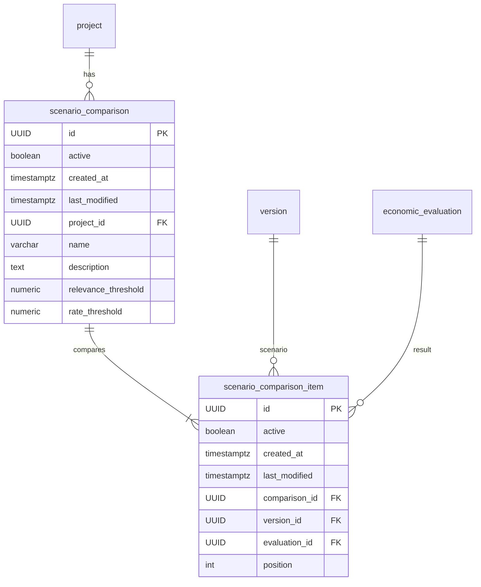
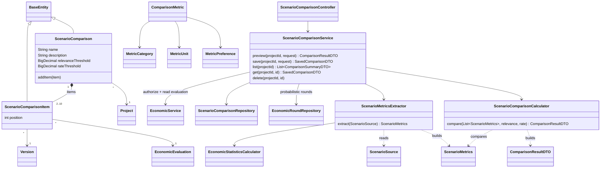

# Scenario comparison

The comparison service puts the **results of two or more scenarios of one
project side by side** and points out the differences that matter. A "result" is
a saved, immutable `EconomicEvaluation` of a version (deterministic or
probabilistic). Nothing is simulated or recalculated by the economic engine: the
comparison only reads saved snapshots.

Package: `org.enerscope.comparison` (`controller`, `service`, `repository`,
`model`, `model/enums`, `dto`).

## What is compared

The first item of a request is the **baseline**; every other scenario is measured
against it. Scenarios are keyed by **evaluation id**, so two evaluations of the
same version (e.g. before and after changing its configuration) can be compared.

| Category | Indicator | Definition | Better |
| --- | --- | --- | --- |
| Financial | `NPV` | Saved net present value | higher |
| Financial | `IRR` | Saved IRR, only when `CALCULATED` | higher |
| Financial | `ROI` | Net cash flow over the horizon / CAPEX | higher |
| Financial | `ROE` | Average annual result after tax / CAPEX | higher |
| Financial | `SIMPLE_PAYBACK`, `DISCOUNTED_PAYBACK` | Saved recovery period, only when `RECOVERED` | lower |
| Cost | `CAPEX` | Capitalizable expense entries (asset purchases) | lower |
| Cost | `OPEX` | Other cash expense entries (excludes depreciation and income tax) | lower |
| Cash flow | `REVENUE` | Cash income entries | higher |
| Cash flow | `TAXES` | Sum of period taxes | neutral |
| Cash flow | `NET_CASH_FLOW` | Sum of period cash flows (undiscounted) | higher |
| Physical | `PRODUCED_VOLUME` | Output of **source nodes** (no connection feeds them) | higher |
| Physical | `EXPORTED_VOLUME` | Exported quantity over all nodes | higher |
| Physical | `LOSSES` | Losses over all nodes | lower |
| Physical | `OPERATING_HOURS` | Operating hours over all nodes | neutral |
| Physical | `EVENTS` | Maintenance/failure events over all nodes | lower |

- Entries are counted with the **economic engine's consolidation rule**: the
  entity must be inside the evaluation boundary and internal transfers (both
  sides inside the boundary) are excluded. Only entries recognized inside the
  horizon count.
- **ROE assumption:** the economic model has no debt financing, so all invested
  capital (CAPEX) is equity. If financing is ever modelled, ROE must divide by
  equity instead.
- No investment (CAPEX = 0) makes ROI/ROE unavailable with status
  `NO_INVESTMENT` — never a division by zero.
- Physical values are raw simulator units (no conversions) totalled over the
  horizon. Production is measured at source nodes so a serial chain is not
  counted twice.
- Besides the totals, the result has **per-node flows** (input, output,
  exported, losses, hours, events) matched across scenarios by node
  `identityId`, and an **annual series** per scenario (cash flow, cumulative cash
  flow, produced and exported volume) for charts.

### Probabilistic evaluations

They are measured **round by round** from their saved `EconomicRound`s and every
indicator is the **mean over the rounds where it exists**. `availableRounds` /
`totalRounds` travel with the value so conditional means (e.g. IRR only defined
in 7 of 10 rounds) stay explicit, and `distribution` carries min/max/P10/P50/P90.
A missing value is **never** replaced by zero.

## Relevant differences

Each non-baseline cell has an `absoluteDelta`, a `relativeDelta` (over
|baseline|) and an assessment: `BETTER`, `WORSE`, `EQUAL`, `CHANGED` (neutral
indicators) or `NOT_COMPARABLE`. A difference is **relevant** when:

- rates (IRR, ROI, ROE) move at least `rateThreshold` (default `0.01` = 1
  percentage point);
- paybacks move at least one year;
- any other value moves at least `relevanceThreshold` relative to the baseline
  (default `0.05` = 5 %); any change counts when the baseline is zero;
- NPV changes sign (`NPV_SIGN_CHANGE`, listed first);
- an indicator exists on one side only for a real reason (e.g. payback never
  recovered → `AVAILABILITY_CHANGE`, assessed `WORSE`). Missing saved data is
  `NOT_COMPARABLE` and never a finding;
- a node exists only on one side (`NODE_ADDED` / `NODE_REMOVED`) or its output
  moves at least `relevanceThreshold` (`NODE_FLOW_CHANGE`).

`findings` lists them sorted by importance (sign changes, availability changes,
indicator changes by size, then nodes), each with a ready-to-show Spanish
`message`. Every indicator row also has `bestEvaluationIds` (empty for neutral
indicators or when all values tie) and every scenario a `bestIn` list.

Amounts in a **different currency** from the baseline's are `NOT_COMPARABLE`.
`warnings` flags, without blocking: `DIFFERENT_CURRENCY`, `DIFFERENT_START_YEAR`,
`DIFFERENT_HORIZON`, `DIFFERENT_WACC`, `MIXED_EVALUATION_MODES`,
`DIFFERENT_SIMULATION_VERSION`, `INCOMPLETE_RESULTS`.

## API

All routes are under `/api/v1/projects/{projectId}/comparisons`, use the
`ApiResponse<T>` envelope and fall through to `anyRequest().authenticated()` in
`SecurityConfig`. Project permissions are checked in the service.

| Method | Path | Permission | Behavior |
| --- | --- | --- | --- |
| `POST` | `/preview` | `VIEW_PROJECT` | Compare without saving |
| `POST` | `/` | `EDIT_PROJECT` | Save the definition (201) and return it with its result |
| `GET` | `/` | `VIEW_PROJECT` | List saved comparisons (no recalculation) |
| `GET` | `/{comparisonId}` | `VIEW_PROJECT` | Read a saved comparison, recalculated from its evaluations |
| `DELETE` | `/{comparisonId}` | `EDIT_PROJECT` | Soft delete |

Request body (`ComparisonRequestDTO`):

```json
{
  "name": "Base vs ampliación",
  "description": "optional",
  "relevanceThreshold": 0.05,
  "rateThreshold": 0.01,
  "items": [
    { "versionId": "…", "evaluationId": "…" },
    { "versionId": "…" }
  ]
}
```

- 2 to 10 items; the first is the baseline. `name` is only required to save.
- An item without `evaluationId` uses the version's **latest** evaluation; when
  saving, the resolved id is stored so reopening compares the same results.
- Every version must be an active version of the project in the path and every
  evaluation must belong to its version (otherwise `404`). The same evaluation
  twice, too few/many items or a non-positive threshold answer `400`.

## Persistence (V24)

Only the **definition** is stored; evaluations are immutable, so the result is
recalculated on read and always matches.



Constraints: `UNIQUE (comparison_id, position)`, `UNIQUE (comparison_id,
evaluation_id)`, `position >= 0`, both thresholds `> 0`. No existing table
changes.

## Classes



Enums: `ComparisonMetric`, `MetricCategory`, `MetricUnit`, `MetricPreference`,
`DifferenceAssessment`, `FindingType`, `ComparabilityWarning`, `EvaluationMode`.
DTOs: `ComparisonRequestDTO` (+`Item`), `ComparisonResultDTO` (+`Scenario`,
`MetricRow`, `MetricCell`, `NodeRow`, `NodeCell`, `Series`, `SeriesPoint`,
`Warning`, `Finding`), `MetricValueDTO`, `NodeFlowDTO`, `ComparisonSummaryDTO`,
`SavedComparisonDTO`. Existing class touched: `EconomicRoundRepository` gains
`findByJobIdOrderByRoundNumberAsc`.

## Known limits

- A saved comparison whose version is later deleted (deactivated) can no longer
  be read: the economic read refuses inactive versions. Delete or re-create the
  comparison.

## Frontend

**Análisis → Comparaciones** (`/projects/:projectId/comparisons`, saved ones at
`/projects/:projectId/comparisons/:comparisonId`). The screen builds the request
(scenario + evaluation per row, first row = baseline, thresholds typed as % and
percentage points), shows the result (scenarios, warnings, relevant differences,
indicator table with deltas and best values, annual chart, per-node flows) and
lets editors save and delete comparisons. See the frontend README.
